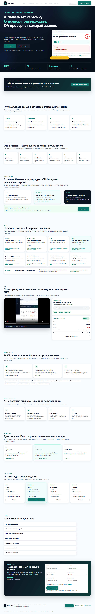

# CallPilot

**AI-контроль качества и постобработка звонков для колл-центров.**

CallPilot расшифровывает звонки, собирает карточку в CRM, проверяет каждый звонок по чек-листу качества и отправляет менеджеру только нарушения и спорные случаи. Это не голосовой бот и не замена операторов — это слой качества и постобработки.



## Что внутри демо

- 6 синтетических звонков: доставка, возврат, техническая ошибка, жалоба, смена адреса, плохая связь.
- Синтетическое аудио двумя нативными русскими голосами (edge-tts).
- Транскрипт с таймкодами.
- Карточка звонка: интент, резюме, решение, следующий шаг, поля CRM.
- QA-чек-лист из 10 критериев с цитатами и severity.
- Auto-pass / manual_review по детерминированным правилам.
- Подтверждение или отклонение звонка менеджером.
- Аудит: что нашла модель и что изменил человек.
- Аналитика: покрытие QA, auto-pass, топ нарушений, очередь менеджера.

## Дизайн-система

Все токены, размеры, отступы, голоса и правила вёрстки сохранены в `DESIGN_SYSTEM.md` — чтобы не подбирать формат заново.

## Скриншоты

| Экран | Файл |
|---|---|
| Landing | `screenshots/landing.png` |
| Landing, 1920 | `screenshots/landing_1920.png` |
| Landing, 2560 | `screenshots/landing_2560.png` |
| Landing, мобильный | `screenshots/landing_mobile.png` |
| Dashboard | `screenshots/dashboard.png` |
| Карточка звонка | `screenshots/call_detail.png` |
| QA-аналитика | `screenshots/qa.png` |
| Оффер | `screenshots/offer.png` |

## Быстрый старт

Из корня проекта:

```bat
start.bat
```

Затем:

```bat
call-center\start.bat
```

Или вручную из папки `call-center`:

```powershell
..\.venv\Scripts\python.exe -m uvicorn call_center_app:app --host 127.0.0.1 --port 8020 --reload
```

Открыть: **http://127.0.0.1:8020**

Приложение использует `.env` из корня проекта. Если `.env` ещё нет, выполните `start.bat` в корне или скопируйте `.env.example` в `.env` и вставьте `AITUNNEL_API_KEY`.

## Как устроен демо-режим

1. `demo_data.py` содержит 6 синтетических звонков.
2. `scripts/build_demo_audio.py` генерирует аудио через AITUNNEL TTS и манифест таймкодов.
3. `scripts/seed_demo.py` прогоняет звонки через реальную модель и сохраняет результаты в `data/seed_results.json`.
4. При первом запуске приложение поднимает SQLite и вставляет кэшированные результаты.
5. Кнопка «Сбросить демо» возвращает исходное состояние без вызовов LLM.
6. Кнопка «Пересчитать» на карточке запускает модель заново для одного звонка.

## QA-правила

Каждый звонок оценивается по 10 критериям:

1. Приветствие и представление.
2. Идентификация клиента.
3. Выявление потребности.
4. Соблюдение скрипта.
5. Достоверность информации.
6. Эмпатия и вежливость.
7. Решение и следующий шаг.
8. Корректное завершение.
9. Комплаенс.
10. Перебивания и молчание.

Модель возвращает по каждому критерию `pass/fail/na`, severity, цитату и `segment_id`. Severity берётся из чек-листа, а не из ответа модели — модель не может занизить критичное нарушение.

`qa_score` пересчитывается детерминированно:

- critical fail: −40;
- high fail: −20;
- medium fail: −10;
- low fail: −5;
- минимум 0.

Звонок уходит в **manual_review**, если:

- есть critical или high fail;
- `qa_score < 85`;
- confidence = low;
- не все критерии оценены;
- интент complaint/refund и негативный sentiment;
- модель сама поставила escalate.

Иначе — **auto_pass**: звонок прошёл автоматически, менеджер его не смотрит.

## Ревью-процесс

```text
pending → confirmed → synced (демо)
       ↘ rejected
```

- `pending`: черновик модели ждёт проверки.
- `confirmed`: менеджер подтвердил карточку; финальная версия и diff сохранены.
- `rejected`: звонок возвращён в ручную обработку с причиной.
- Все действия пишутся в `call_reviews` и аудит.

В карточке можно:

- прослушать звонок;
- кликнуть на реплику или цитату нарушения и перемотать аудио;
- изменить карточку;
- подтвердить или отменить нарушение;
- подтвердить звонок и отправить в CRM (демо);
- отклонить с причиной.

## Структура

```text
call-center/
├── call_center_app.py       # FastAPI + маршруты
├── call_store.py            # SQLite, ревью, метрики, демо-данные
├── demo_data.py             # 6 синтетических звонков
├── templates/               # landing, dashboard, call detail, QA, offer
├── static/                  # CSS, JS, логотип, аудио
├── data/
│   ├── audio_manifest.json  # таймкоды реплик
│   ├── seed_results.json    # кэш результатов live-прогона
│   └── call_center.db       # создаётся локально, не коммитится
├── scripts/
│   ├── build_demo_audio.py  # TTS + ffmpeg
│   ├── seed_demo.py         # live-прогон 6 звонков
│   ├── screenshots.py       # скриншоты через Playwright
│   ├── record_demo.py       # запись демо-видео
│   └── stop_callpilot.ps1   # остановка старого сервера
├── screenshots/             # готовые экраны
├── start.bat
├── OFFER.md
├── OUTREACH.md
└── outreach_targets.csv
```

## Скрипты и видео

```powershell
# из корня проекта
.venv\Scripts\python.exe call-center\scripts\build_demo_audio.py
.venv\Scripts\python.exe call-center\scripts\seed_demo.py
.venv\Scripts\python.exe call-center\scripts\screenshots.py
.venv\Scripts\python.exe call-center\scripts\record_demo.py
```

`seed_demo.py` тратит деньги на AITUNNEL. `build_demo_audio.py` использует бесплатный edge-tts с нативными русскими голосами. Скриншоты и сам интерфейс работают на кэше.

`record_demo.py` записывает демо-видео на 2–3 минуты: Playwright проходит по интерфейсу, edge-tts озвучивает сценарий нативным русским голосом с паузами на знаках препинания, ffmpeg собирает MP4. Результат: `demo/callpilot-demo.mp4`. Видео не коммитится, генерируется локально.

## Деплой

В корне есть `Dockerfile` и `render.yaml`.

Переменные окружения:

- `AITUNNEL_API_KEY` — секрет;
- `AITUNNEL_BASE_URL` — `https://api.aitunnel.ru/v1/`;
- `AITUNNEL_MODEL` — например, `deepseek/deepseek-v4.1-flash-1017`;
- `CALLPILOT_DB_PATH` — путь к SQLite, по умолчанию `/app/call-center/data/call_center.db`.

Для публичного демо на Render:

1. Подключите репозиторий.
2. Render прочитает `render.yaml`.
3. Вставьте `AITUNNEL_API_KEY` в переменные окружения.
4. Для сохранения подтверждений между перезапусками оставьте диск `callpilot-data`.

Для быстрого демо можно жить без диска: при перезапуске БД пересоздастся из `seed_results.json`.

## Ограничения

- Только синтетические звонки; реальные записи не включены.
- Нет реальной телефонии, STT и CRM-интеграции — это следующий шаг пилота.
- SQLite подходит для демо и пилота, но не для высокой конкурентной нагрузки.
- Для реальных ПДн нужны согласие на запись, маскирование, срок хранения и 152-ФЗ.
- LLM может ошибаться; поэтому есть QA-правила, эскалация, человек и аудит.

## Следующий шаг для клиента

Пилот на 100–300 звонках:

1. Подключаем записи из телефонии.
2. Настраиваем чек-лист под клиента.
3. Прогоняем звонки и сверяем с ручной проверкой.
4. Показываем покрытие QA, auto-pass, нарушения, правки и экономику.

Подробнее — в `OFFER.md`.
